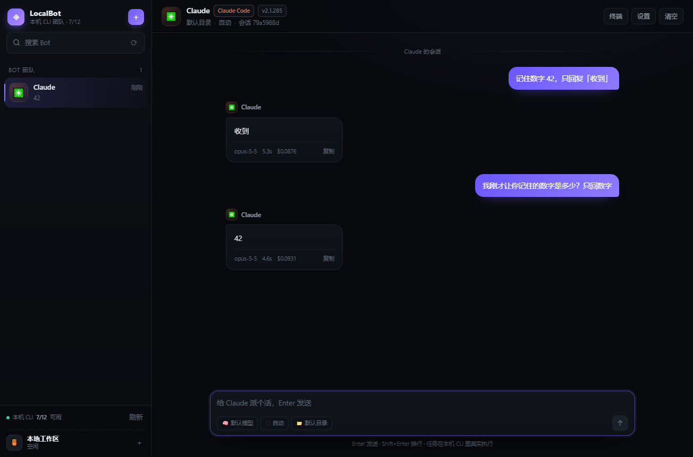

# LocalBot



把**本机已经装好的 AI CLI** 变成一支有名字、有头像、有记忆的 Bot 团队。思路照搬 Grok Bot，但"Bot 的电脑"换成你自己的电脑，"模型"换成本机任意一个 CLI。

> Grok Bot 的核心是：Bot 是同事，不是工具。给它一个名字、一台电脑、一个长期会话，然后把活丢过去。
> LocalBot 保留这套交互，把执行体从 xAI 的云电脑换成 `claude` / `codex` / `gemini` / `codebuddy` … 这些你已经付过钱的本地 CLI。

## 快速开始

```bash
npm install
npm start
```

Windows 上也可以直接双击 **`start.bat`**（会自动装依赖）。

首次启动会自动扫描 PATH 里的 AI CLI，识别到几个就能用几个。点右上角 **＋** 选一个 CLI，起个名字，就可以开聊。

## 它做了什么

| 能力 | 说明 |
| --- | --- |
| 一个 Bot = 一个 CLI | 同一个 CLI 可以建多个 Bot，分别绑不同工作目录和角色设定 |
| 真流式 | 直接解析 CLI 的 `stream-json` / JSONL 输出，文字边生成边显示 |
| 工具可见 | 读文件、跑命令、改代码都以卡片展示，可展开看完整输入输出 |
| 会话延续 | 记住 CLI 的 session id，下一轮自动 `--resume`，上下文不断 |
| 多 Bot 并行 | 每个 Bot 独立进程，切走不中断，侧边栏有小绿点表示在跑 |
| 工作目录 | Bot 的所有文件操作限定在你指定的目录 |
| 角色设定 | 每轮自动注入，用来固定人设/分工 |
| 权限模式 | 自动 / 谨慎 / 只读，映射到各 CLI 自己的权限参数 |
| 一键安装 | 没装的 CLI 在弹窗里点"安装"就装（npm / 官方脚本），日志实时回显 |
| 秒开 | 启动只做 PATH 查找（~60ms）先出界面，版本号缓存到磁盘并后台并发补齐（第一次约 2.5s，之后 ~60ms） |
| 窗口内登录 | 底部内嵌真终端（node-pty + xterm.js），CLI 的交互式授权直接在应用里完成，不用跳外部终端 |
| 群聊交班 | 多个 Bot 同屏：@ 谁谁回答，Bot 回答里 @ 别人自动把活交出去，一条消息能串起 2~4 个 Bot |

## 已内置的 CLI

装了就能用（自动探测版本）：`claude`、`codebuddy`、`codex`、`gemini`、`opencode`、`copilot`、`grok`。

未安装但支持一键装：Qoder（跳官网）、Cursor CLI、Qwen Code、Amp、Aider。

每个 CLI 的输出协议差异由 `electron/parsers.js` 抹平：

- `claude` / `codebuddy` → `--output-format stream-json --include-partial-messages`
- `codex` → `codex exec --json`（+ `resume`）
- `gemini` → `-o stream-json`
- `opencode` → `run --format json`
- 其它 → 通用解析：能认出 JSON 事件就抽文本，认不出就当纯文本流

## 加一个新的 CLI

编辑 `electron/agents.js` 里的 `CATALOG`，加一条：

```js
{
  id: 'mycli',
  name: 'My CLI',
  emoji: '🧪',
  color: '#8888ff',
  bin: 'mycli',                 // PATH 里的可执行文件名
  proto: 'generic',             // claude | codex | gemini | opencode | generic
  stdinPrompt: false,           // prompt 走 stdin 还是 argv
  session: false,               // 支不支持续聊
  permission: false,
  install: { kind: 'npm', pkg: 'my-cli' },
  login: 'mycli login',
  models: [],
}
```

如果它的输出是结构化 JSON，在 `parsers.js` 里加一个 `xxxParser`，注册到 `createParser` 即可。不改也能用，只是变成纯文本渲染。

## 目录结构

```
electron/
  main.js       窗口、IPC、安装流程
  agents.js     CLI 目录 + 每种 CLI 的命令行拼装
  parsers.js    各 CLI 输出协议 → 统一事件
  runner.js     进程管理、流式组装、会话 id 回传
  store.js      bots.json / chats/*.json 持久化
  preload.js    contextBridge 暴露的白名单 API
renderer/
  index.html    Vue3 模板（无构建，本地 vendor）
  app.js        状态、事件订阅、markdown 渲染
  style.css     深色主题
scripts/
  test-runner.js  命令行验证某个 CLI 适配器是否跑通
  make-icon.js    重新生成应用图标
```

数据存在 `%APPDATA%\LocalBot\data\`（macOS/Linux 在对应 userData 目录），删掉即重置。

## 网络与代理（很重要）

默认「**智能**」：按 CLI 区分，不做一刀切。

| CLI | 策略 | 原因 |
| --- | --- | --- |
| 海外（claude / gemini / codex / copilot / amp …） | **沿用系统代理** | 账号通常依赖固定地区出口，突然直连会让 IP/地区突变，有风控甚至封号风险 |
| 国内（codebuddy / qwen …） | **直连** | 它们的 `setProxy` 拿到代理变量会抛 `TypeError`，随后报 `socket disconnected before secure TLS connection` |
| npm 安装 | 沿用系统代理 | 否则装包会挂 |

设置里还能选「全部跟随系统 / 全部直连 / 自定义代理」，也可以对**单个 CLI** 覆盖；「开始诊断」会按实际生效的策略逐个测 TLS 握手，例如：

```
api.anthropic.com   代理  正常 · 561ms
api.openai.com      代理  正常 · 562ms
copilot.tencent.com 直连  正常 · 32ms
```

> ⚠️ 除非你确定网络不需要代理，**不要把海外 CLI 切成直连**。终端里那个「仅此 CLI 改直连」按钮也只作用于当前这一个 CLI。

## 端口冲突

codebuddy 系 CLI 有个「稳定的本地守护端口」（默认 `61172`），而 **WorkBuddy / CodeBuddy 桌面版通常正占着这个端口**。所以：

- **非交互调用**（Bot 干活）：自动分配空闲端口传 `--port`，不受影响。
- **交互式登录**：CLI 不接受 `--port`（会静默退出），撞端口时终端里会直接说明原因，建议关掉宿主程序后点「重启」，或用右上角「系统终端」到外面登录。

## 群聊怎么跑

一个房间放多个 Bot，规则刻意做得简单可预期：

1. **@ 谁谁回答**：用户消息里 @ 了几个成员，就按顺序依次回答（串行，后一个能看到前一个的结果）。
2. **没 @ 找负责人**：没人被点名叫时，由群设置里的「负责人」先接；它拿不准可以再 @ 别人。
3. **回答里 @ = 交班**：Bot 在回答末尾 @ 某个成员，那个成员会被自动叫起来接着做。
4. **一轮最多 4 跳、每人只说一次**：防止两个 Bot 互相甩锅或无限循环。

上下文怎么保证：每个 Bot 在这个群里都有**独立的 session**，同时每轮 prompt 里会带上「其他人的最近发言」（最多 14 条 / 2400 字），所以它既记得自己做过什么，也知道别人刚说了什么。群消息存在 `chats/<群id>.json`，每条带 `sender`，界面上就能显示是谁在说话。

## 启动为什么会快

`electron/detect.js` 分两步：

1. **fast()** —— 只判断「装没装」+ 读 `agents-cache.json` 里的版本号，同步返回，窗口立刻可用。
2. **full()** —— 后台并发（4 路）跑 `<cli> --version`，每探到一个就推一次 `agents:update` 让界面自己更新；结果按「路径 + 文件 mtime」缓存，CLI 没升级就不会重复探。

想看耗时：

```bash
node scripts/bench-detect.js
```

## 排错

```bash
# 单独验证某个 CLI 适配器（不开界面）
node scripts/test-runner.js claude "用一句话介绍自己"
node scripts/test-runner.js codex  "回复 ok"
```

- **提示未登录**：点消息里的"在窗口内登录"，底部会拉起该 CLI 的交互式终端（claude 系会给出"输入 /login"按钮），授权完成后关掉面板、把消息重发一次即可。
- **提示找不到 CLI**：说明它不在 PATH 里，用弹窗里的"安装"或自己装完后点"刷新"。
- **一直是空输出**：多半是该 CLI 的 `proto` 猜错了，先用 `test-runner.js` 确认原始输出格式。
- **登录报 TLS / socket disconnected**：先看设置里的诊断。CodeBuddy 这类国内 CLI 需要直连（智能模式已默认如此）；海外 CLI 若代理挂了，请修好代理而不是切直连。
- **终端里提示端口 61172 被占用**：关掉 WorkBuddy / CodeBuddy 桌面版再重试，或改用「系统终端」。

## 已知边界

- 目前是**单机、单用户**：没有云电脑、没有手机端。群聊是本地串行编排（同一时刻只有一个成员在跑），不是云端并行调度。
- 权限审批是**事前模式选择**，不是 Grok Bot 那种"执行到一半弹卡片让你点同意"。原因是 CLI 的非交互模式无法中途接管；要审批就用 `plan`/`谨慎` 模式，或者换成 CLI 的交互模式另做 PTY 层。
- 长任务不会自动超时，进程随窗口关闭一起 kill。
